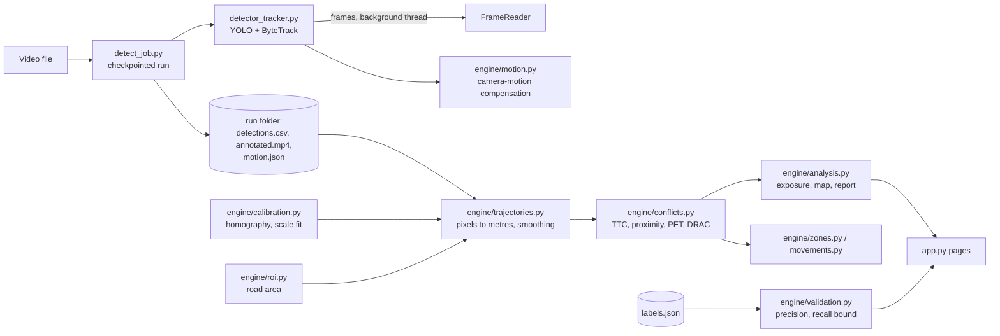

# How NearMiss is built

NearMiss is a Streamlit app (`app.py`) on top of a plain-Python engine (`engine/`) that has no Streamlit in it, so
every number can be tested without the app.

## Pipeline

1. **Detect** (`detect_job.py`, `detector_tracker.py`). Frames are decoded on a background thread and passed one by
   one to a YOLO model and ByteTrack. The device is picked automatically: NVIDIA GPU, Apple chip, Intel GPU (through
   OpenVINO, exported once into `openvino_cache/`), or the CPU. Every 30 s of video the job writes a checkpoint
   (`partial/`), so a stopped run resumes where it stopped.
2. **Calibrate** (`engine/calibration.py`). Clicked points on the road give a homography from pixels to metres.
   Extra known distances check it, and a least-squares scale fit can correct it.
3. **Trajectories** (`engine/trajectories.py`). Each box's ground point is mapped to metres (after camera-motion
   compensation), split at gaps, resampled to 10 Hz and smoothed with a local linear fit that also gives velocity.
4. **Conflicts** (`engine/conflicts.py`). Every pair of road users that could interact is checked: time to collision,
   closest distance, and optionally PET (crossing paths) and DRAC (braking needed). False-alarm filters and
   de-duplication run before events are numbered.
5. **Review and report** (`engine/validation.py`, `engine/review_pack.py`, `engine/analysis.py`). A person labels each
   event; precision and a recall bound come only from those labels.

## Where things live

| Path | What |
| --- | --- |
| `app.py` | All pages. One function per page (`page_detect`, `page_results`, ...). |
| `detect_job.py` | Checkpointed detection run: resume, batch, joining video chunks. |
| `detector_tracker.py` | Model loading (incl. OpenVINO), tracking loop, drawing, privacy blur on the video. |
| `engine/` | Everything measurable: calibration, trajectories, conflicts, validation, zones, movements, quality. |
| `tools/` | Command-line helpers: model comparison, benchmark, synthetic data, VisDrone training notebook. |
| `tests/` | `python -m pytest tests`; runs on GitHub Actions on every push. |
| `runs/` | One folder per recording (git-ignored). |

## A run folder

`source.mp4` (original, unblurred), `annotated.mp4` (blurred), `detections.csv`, `meta.json` (written last: a folder
without it is unfinished), `calibration.json`, `settings.json`, `labels.json`, and optional `motion.json`,
`roi.json`, `zones.json`, `recording_info.json`. While detection runs, `partial/` holds the checkpoint.
