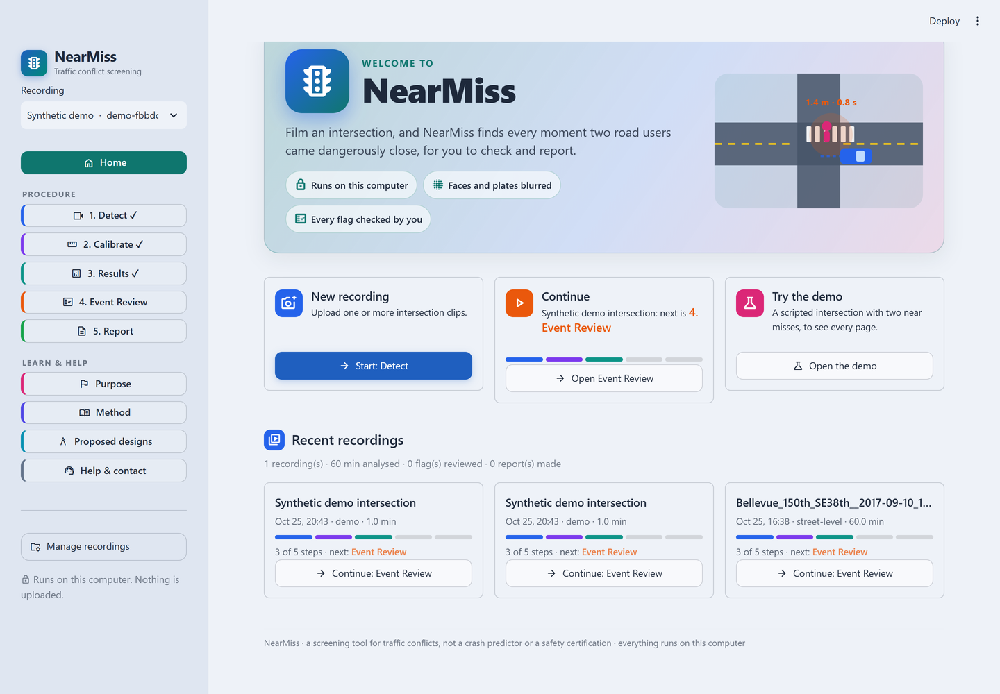
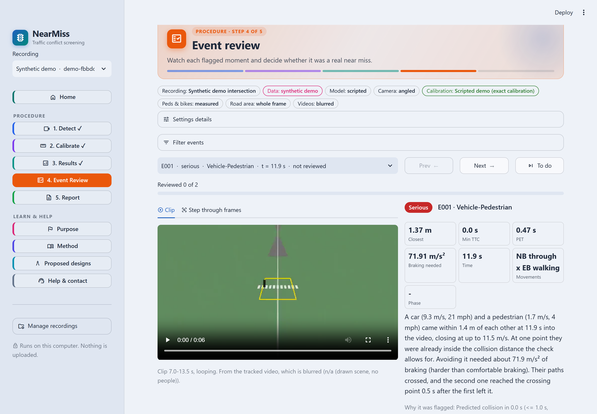
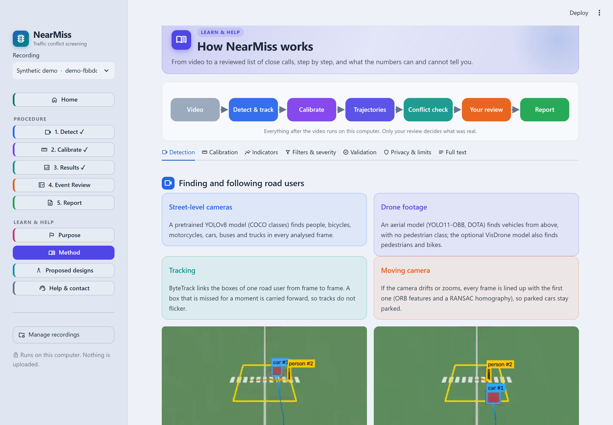

<b>Find the dangerous spots at an intersection before the crashes happen.</b> 
NearMiss turns ordinary traffic video into a checked list of close calls between cars, cyclists and pedestrians.

## The problem
Serious crashes at any one intersection are rare, so crash records take years to show that a crossing is dangerous,
and by then people have been hurt. **Near misses** (a car and a pedestrian coming within a metre or two of each other)
happen far more often. Counting them shows the danger in hours of video instead of years of crash reports. Doing that
by hand means watching hours of footage; NearMiss does the watching.

## What it does
| Step | What happens |
| --- | --- |
| **1. Detect** | Finds and follows every car, bus, truck, bicycle and pedestrian in the video (YOLO + ByteTrack). Street-level or drone footage. |
| **2. Calibrate** | You click a rectangle of known size on the road, so pixels become metres. |
| **3. Results** | Flags every close call: how close they came, time to collision, post-encroachment time, braking needed. Map, heat layer, counts per movement. |
| **4. Event Review** | You watch each flagged moment and mark it *real* or *false alarm*. Only your review decides what counts. |
| **5. Report** | A report a city, school board or community group can act on, with faces and plates blurred. |

Everything runs on your own computer: footage is never uploaded.

| Event Review | How it works (in the app) |
| --- | --- |
|  |  |

## Try it (about 10 minutes)
You need **Python 3.12, 3.13 or 3.14** ([python.org](https://www.python.org/downloads/); on Windows tick *Add python.exe
to PATH*).

1. Download this repository: green **Code** button → **Download ZIP**, and unzip it. (Or `git clone`.)
2. Open a terminal in the unzipped folder and run the setup script. It installs everything and opens the app in your
   browser:
   - Windows: `powershell -ExecutionPolicy Bypass -File .\setup.ps1`
   - Mac or Linux: `./setup.sh`
3. On the **Home** screen click **Try the demo**: a scripted intersection with two near misses, so every page works
   without your own footage. Then upload a real clip on **Detect**.

The first run downloads the detection model (internet needed once).

## Results so far
- A **60-minute** real intersection recording (Bellevue, WA) analysed on an ordinary laptop: detection runs at about
  **6x real time** (an hour of video in about 10 minutes), or about **15x** in the fastest mode.
- **110 automated tests** check the maths (distances, time to collision, calibration, filters) against scenes with a
  known answer. They run on every push.
- Honest limits: it is a **screening tool, not a crash predictor**. Calibration quality, missed detections and the
  reviewer's labels are all shown in the app, and every severity is marked *provisional* until the calibration is
  checked.

## Where things are
| Path | What it is |
| --- | --- |
| `app.py` | The app: every page (Home, the five steps, Purpose, Method, Help). |
| `engine/` | The maths, with no user interface: calibration, trajectories, conflict indicators, validation, privacy. |
| `detector_tracker.py`, `detect_job.py` | Detection and tracking, with resume after a stop and fast Intel / NVIDIA / Apple paths. |
| `tests/` | The automated tests. |
| `sample_data/` | The synthetic demo intersection. |
| `tools/` | Benchmarks, model comparison, and a Colab notebook to train the drone model. |
| `docs/` | [Every feature in detail](docs/FEATURES.md) · [How it is built](docs/ARCHITECTURE.md) · [Data statement](docs/DATA.md) · [Contributing](docs/CONTRIBUTING.md) |

## Disclosure (Congressional App Challenge)
Detection uses pretrained models I did not train:
- **Street-level video:** YOLOv8 (Ultralytics, COCO classes: person, bicycle, motorcycle, car, bus, truck).
- **Drone video:** YOLO11-OBB (Ultralytics, trained on the DOTA aerial dataset). Vehicles only.
- **Optional:** `nearmiss-visdrone.pt`, a YOLO11s we fine-tuned for 30 epochs on VisDrone with
  `tools/train_visdrone_colab.ipynb` on Google Colab.
- **Tracking:** ByteTrack.

##AI Usage
-Models utilized AI for detection
-Helped with the aesthetics and UI of the website/app
